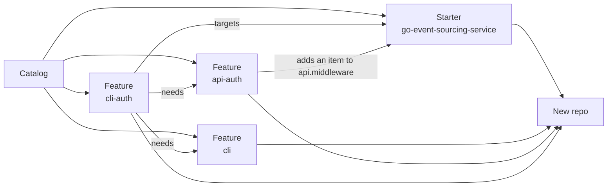

# feature-compose

feature-compose makes a new repo from one **starter** and the **features** that you select. It also selects
the features that your features need, asks each question one time, and writes all files in one pass.

```shell
feature-compose new go-event-sourcing-service my-service --feature cli-auth
```

This command makes a Go service with an event store, a CLI for the service, and an API key that the API
checks and the CLI sends. You asked for one feature, `cli-auth`. The tool also selected `cli` and `api-auth`,
because `cli-auth` needs them.

## Why feature-compose

A team makes many repos of a few kinds: services, CLIs, libraries. Each repo also needs some optional parts:
authentication for its API, a CLI, a release workflow, an example. One template for each kind of repo cannot
hold each combination of these parts:

- **A part in each template:** you copy the part into each template that needs it. The copies change apart.
- **A part in a template of its own:** the second template must change files of the first, for example
  `main.go`. So it needs a script that edits the files after the render, and the script breaks when the
  first template changes.
- **Parts that depend on each other:** a CLI and its API must use the same method of authentication. Two
  templates ask the question two times, and nothing stops two different answers.

feature-compose keeps each part as one feature. A feature names the starters that it works with, the
features that it needs, and the lines that it adds to the files of the starter. The tool joins the starter
and the features in one render, and no step changes a file of the catalog after it.

A starter can also start from the output of a generator, for example `mix phx.new`, so that the repo gets the
latest version of the generator. The tool then changes the generated files only at the places that the starter
names, and it stops when a place is not in the output of the generator.

## How It Is Different From a Template Tool

Template tools, for example [cookiecutter](https://github.com/cookiecutter/cookiecutter),
[copier](https://github.com/copier-org/copier) and [scaffold](https://github.com/hay-kot/scaffold), make a
repo from one template. feature-compose makes a repo from one starter and many features.

| | A template tool | feature-compose |
| --- | --- | --- |
| You start from | One template for each kind of repo | One starter, and the features that you select |
| An optional part | A condition in the template, or a second template with a hook that edits shared files | A feature with its own files. It adds lines to shared files only through extension points |
| Parts that depend on each other | You run each template, and you answer its questions again | A feature names its needs. The tool selects them and asks each question one time |
| One part for many kinds of repo | A copy in each template | One feature names each starter that it works with |
| Mistakes in the templates | You find them when you make a repo | `feature-compose check` finds them first, and CI can make a repo of each combination |

feature-compose does not change a repo after it makes it. It cannot add a feature to a repo that you
changed, and it cannot update a repo to a new version of the catalog. Some template tools, for example
copier, can update a repo.

## Concepts

| Concept | Meaning | Example in this repo |
| --- | --- | --- |
| Catalog | A folder that holds the starters and the features. You can keep your own catalog. | `catalog/` |
| Starter | The files that a new repo of one kind starts from. Each repo has one starter. | `chi-api`, `go`, `go-event-sourcing-service` |
| Feature | A part that you can add to a repo. It adds files, and it adds items to extension points. | `cli`, `api-auth`, `cli-auth`, `process-manager`, `push` |
| Target | A starter that a feature works with. Each feature names its targets. | `cli` targets `chi-api`, `go` and `go-event-sourcing-service` |
| Need | A feature that another feature cannot work without. The tool selects it for you. | `cli-auth` needs `cli` and `api-auth` |
| Option | A question of a starter or a feature. Its answer selects a variant of the files. | `api-auth` has the option `method`, with the values `api-key` and `oauth` |
| Extension point | A named list in one file of a starter or a feature. Other features add items to the list, and the file writes each item. | `api.middleware` in the server of the API, `cli.commands` in the root command of `cli` |

This is how the concepts fit together:



- The starter gives the base files of the repo, and it declares its extension points.
- A feature works only with a starter that its `targets` name.
- When you select a feature, the tool also selects its needs. A feature can read an option of its need, so two
  features follow one answer: `cli-auth` sends the credential of the `method` of `api-auth`.
- A feature changes a file of the starter only through an item of an extension point. The file of the
  starter writes the items. So the feature and the starter can change apart.

## Get Started

1. Install feature-compose. The installer needs `sh`, `curl`, `jq`, `tar` and `gzip`:

   ```shell
   sh <(curl -fsSL https://raw.githubusercontent.com/hpcsc/feature-compose/main/scripts/install.sh)
   ```

2. Add a catalog. To start with the catalog of this repo, add the known catalog `hpcsc`. The tool clones the
   repo, and writes the catalog in its config file:

   ```shell
   feature-compose catalog add hpcsc
   ```

   `feature-compose catalog list --known` lists the known catalogs. To add another catalog, give its git URL or
   its folder, for example `feature-compose catalog add team git@github.com:team/catalog.git`.
   `feature-compose catalog sync` gets the newest commit of each catalog later.

3. See the starters and the features of the catalog. In a terminal, `show` opens a tree that you can
   browse:

   ```shell
   feature-compose show
   ```

4. Preview a repo. `--dry-run` prints the features, the options, the commands and the files of the
   repo, and writes nothing:

   ```shell
   feature-compose new go my-tool --feature cli --dry-run
   ```

5. Make the repo. In a terminal, `new` opens a form, where you can select more features and change the
   answers. The button `Write the repo` shows the preview, and Enter writes the repo:

   ```shell
   feature-compose new go my-tool --feature cli
   ```

   With `--no-prompt`, `new` opens no form and gives each option its default.

   A starter that runs a generator, for example `mix phx.new`, also needs
   [ast-grep](https://ast-grep.github.io) and the generator on the `PATH`.

`new` writes the repo to `./my-tool`, and then runs the commands of the starter, for example `go mod tidy`.
After the form, it also prints the command that makes the same repo again.

To make a catalog of your own, start with `feature-compose init my-catalog`.
[Start a Catalog and Write Its First Feature, Step by Step](docs/start-a-catalog.md) goes from an empty folder to a
feature that `check --build` tests.

## The Catalog of This Repo

| Starter | What the repo gets |
| --- | --- |
| `chi-api` | A Go HTTP API with chi, whose routes are under `/api`, with an example of a public route and of a protected route |
| `go` | A Go module with an example package, its unit tests, a pre-push hook, and a CI workflow |
| `go-event-sourcing-service` | A Go service with an event store, an HTTP API, and a catchup process |
| `phoenix` | A Phoenix app from the latest `mix phx.new`, with contexts at the bottom, use cases above them, and a layer list that `mix xref.layers` checks. Its sample, the desk of a lending library, shows each part of the structure one time. It needs Elixir, the archive `phx_new` and `ast-grep` |

| Feature | Targets | What it adds |
| --- | --- | --- |
| `cli` | `chi-api`, `go`, `go-event-sourcing-service` | A command line program with releases from GoReleaser, and a command that updates it |
| `api-auth` | `chi-api`, `go-event-sourcing-service` | A check of an API key or of an OAuth access token on each protected route of the API |
| `cli-auth` | `chi-api`, `go-event-sourcing-service` | The credential in each request of the CLI, in the method of `api-auth`: the API key, which `store-key` keeps in the OS credential store, or the access token of a login at the issuer. It needs `cli` and `api-auth` |
| `process-manager` | `go-event-sourcing-service` | The example of a process manager, a payment to another bank, with fakes of its outside systems |
| `push` | `go-event-sourcing-service` | The WebSocket route `/api/ws` of the API, which sends each new event of the service to its clients. The option `delivery` reads the events from the notifications of Postgres (`pg-notify`) or from NATS (`nats`) |
| `oban` | `phoenix` | Oban jobs in Postgres, and a `Jobs` module that adds a job from a struct in a `Multi`. It adds Oban to six files that `mix phx.new` writes |

## More Documents

| Document | What it tells |
| --- | --- |
| [Install feature-compose and Point It at a Catalog](docs/install-and-configure.md) | The options of the installer, the config file, and the update of the tool |
| [What Each Command of feature-compose Does](docs/commands.md) | `new`, its preview and its form, `show`, `check`, `version` and `update` |
| [Start a Catalog and Write Its First Feature, Step by Step](docs/start-a-catalog.md) | `init`, `add`, `check` and `check --build`, from an empty folder to a tested feature |
| [Write the Starters and the Features of a Catalog](docs/catalog.md) | The folders of a catalog, `starter.yml`, `feature.yml`, options, needs, extension points and templates |
| [Build, Test and Release feature-compose](docs/development.md) | The tasks of this repo, the test of the combinations of the catalog, and the releases |
| [How the end-to-end tests work](docs/e2e-tests.md) | The tests that run the binary in a terminal |
| [PROPOSAL.md](PROPOSAL.md) | The design of the tool, its goals and its decisions |
