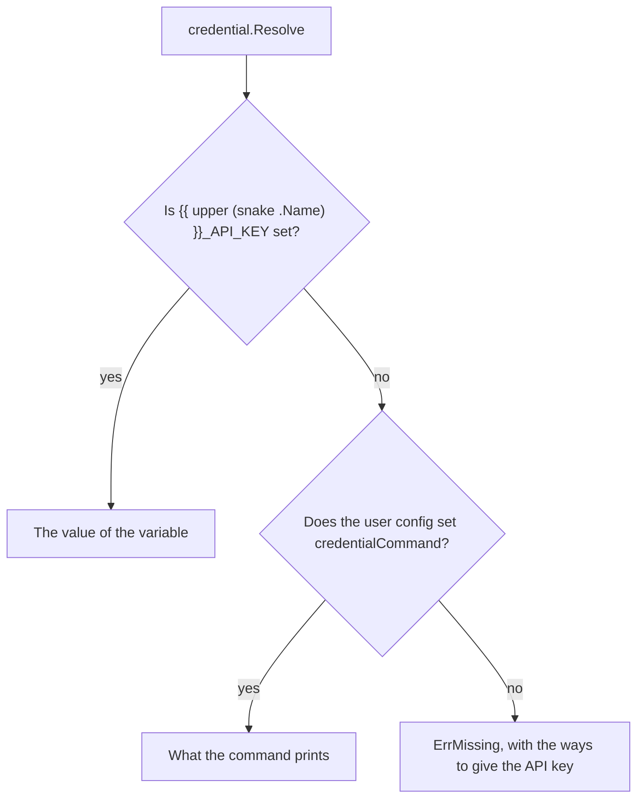

# The API Key of the CLI

`{{ kebab .Name }}` sends an API key to the API of this repo, in the header `Authorization: Bearer <key>`. The API
checks the key with the method `{{ option "api-auth.method" }}`, and the CLI follows the method of the API.
[api-auth.md](api-auth.md) tells how the API checks a key, and how to make a key and its hash.

## Give the CLI Its API Key

`{{ kebab .Name }}` uses the first of these sources that gives an API key:

1. The environment variable `{{ upper (snake .Name) }}_API_KEY`
2. The output of `credentialCommand` in `$XDG_CONFIG_HOME/{{ kebab .Name }}/config.yaml`, or in
   `~/.config/{{ kebab .Name }}/config.yaml` when `XDG_CONFIG_HOME` is not set

`{{ kebab .Name }} auth status` shows which source gives the API key. It does not show the API key.

Use the environment variable in CI and in scripts.

### Read the API Key from a Password Manager

`credentialCommand` runs through `sh`, and `{{ kebab .Name }}` uses what the command prints. With it, the API key
stays in your password manager:

```yaml
credentialCommand: op read op://Private/{{ kebab .Name }}/api-key
```

`{{ kebab .Name }}` reads `credentialCommand` only from your own config file, and never from a file in a
repository.

## How the CLI Gets Its API Key

`credential.Resolve` gives the API key that `{{ kebab .Name }}` sends to its API. It tries a fixed list of sources
and takes the first that gives a value. The code is in `internal/credential`, the API client is in
`internal/apiclient`, and the `auth` command is in `internal/cli/auth.go`, in the package of the root command.

### Call the API from a Command

A command of the CLI calls the API through `apiclient.Client`. Before each request, the client calls
`credential.Resolve` and sends the key as `Authorization: Bearer <key>`. Give the client the base URL of the
API, which ends with `/api`, and give each call the path of the route after `/api`:

```go
client := apiclient.New("http://localhost:3333/api")
response, err := client.Do(ctx, http.MethodPost, "/accounts", body)
if err != nil {
	return err
}
defer response.Body.Close()
```

- With no API key, `Do` sends no request, and its error is `credential.ErrMissing` with the ways to give a key.
- When the API answers 401, `Do` returns no response. Its error is `credential.ErrRefused`, with the source of the
  refused key and the ways to give a key.
- `Do` gives each other answer to the command as the API gave it, for example 400 or 403.
- The client keeps no key. Each call resolves the key again, so a changed variable or password manager takes effect
  at the next call.

### The Files

| File | Job |
| --- | --- |
| `internal/credential/credential.go` | `Resolve`, which tries the sources in order. `Credential`, which holds the value and the name of its source. |
| `internal/credential/config.go` | Finds the user config, and reads `credentialCommand` from it. |
| `internal/credential/command.go` | Runs `credentialCommand` through `sh`. |
| `internal/apiclient/client.go` | `Client`, which sends the API key on each call to the API, and turns the answer 401 into `credential.ErrRefused`. |
| `internal/cli/auth.go` | The `auth` command. It calls `credential.Resolve` and prints the source. |

### The Order of the Sources



The order has these reasons:

- **The environment variable comes first.** CI and scripts set it for one run. The value for that run must
  replace a value that the user keeps for all runs.
- **`credentialCommand` comes last.** It is for a user who keeps the API key in a password manager. It runs a
  program each time, so the CLI runs it only when no other source gives a value.

`Credential.Source` names the source: the name of the variable, or `the credentialCommand in <path>`. `auth status`
prints it. No command prints the API key itself.

### The Rules That Keep the API Key Safe

| Rule | Reason |
| --- | --- |
| The CLI has no flag for the API key. | The shell history keeps the value of a flag, and other users of the machine can see it in `ps`. Tests and CI use the environment variable. |
| The CLI reads `credentialCommand` only from the user config. | A file in a repository can come from another person. If that file can set a command, the CLI runs a command of that person on your machine. |
| `credentialCommand` writes its stderr to the terminal. | When a password manager fails, for example because it is locked, the user sees its message. |
| The CLI does not store the API key. | The key stays in the variable or in the password manager, and the CLI writes no file. |

### Environment Variables

| Variable | Job |
| --- | --- |
| `{{ upper (snake .Name) }}_API_KEY` | Gives the API key. It comes before all other sources. |
| `XDG_CONFIG_HOME` | Holds the folder `{{ kebab .Name }}`, with `config.yaml`. If it is empty or not an absolute path, the folder is `~/.config/{{ kebab .Name }}`. |

### The Tests

The unit tests are in `internal/credential` and `internal/apiclient`. Run them with
`go test -tags=unit ./internal/credential ./internal/apiclient`. The tests of the client call a test server that
runs `auth.Middleware` of `internal/auth`, with the hashes of two keys of the test, so they check the client
against the check of the API of this repo.

- Each test calls `isolate`. It sets `XDG_CONFIG_HOME` to a new temporary folder and clears
  `{{ upper (snake .Name) }}_API_KEY`. So no test reads your config.

The e2e tests in `e2e/tests/auth.test.ts` run the binary with the same environment variables.
