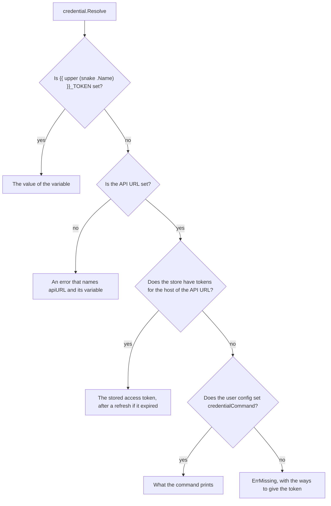
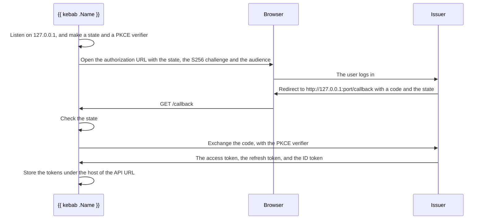

# How the CLI Logs In and Sends Its Access Token

`{{ kebab .Name }}` sends an access token to the API of this repo, in the header `Authorization: Bearer <token>`.
The API checks the token with the method `{{ option "api-auth.method" }}`, and the CLI follows the method of the API: it
logs the user in at the issuer of the API, and asks for a token for the audience of the API.
[api-auth.md](api-auth.md) tells how the API checks a token.

## Give the CLI Its Token

`{{ kebab .Name }}` uses the first of these sources that gives a token:

1. The environment variable `{{ upper (snake .Name) }}_TOKEN`
2. The tokens that `{{ kebab .Name }} auth login` stores
3. The output of `credentialCommand` in `$XDG_CONFIG_HOME/{{ kebab .Name }}/config.yaml`, or in
   `~/.config/{{ kebab .Name }}/config.yaml` when `XDG_CONFIG_HOME` is not set

`{{ kebab .Name }} auth status` shows which source gives the token. It does not show the token.

Use the environment variable in CI and in scripts.

### Log In

`{{ kebab .Name }} auth login` opens a browser, where you log in at the issuer. The CLI uses the OAuth
authorization code flow with PKCE, and the issuer sends the login back to a server on `127.0.0.1`.

If the machine has no browser, for example in an SSH session, `auth login` shows a URL and a code. Open the URL on
any device and type the code. `auth login --device` does the same on a machine with a browser. If the environment
variable `BROWSER` is set, `{{ kebab .Name }}` opens the browser that it names.

```shell
{{ kebab .Name }} auth login            # log in in a browser
{{ kebab .Name }} auth login --device   # log in with a code on another device
{{ kebab .Name }} auth status           # show the source, the account and the expiry time
{{ kebab .Name }} auth token            # print the access token, for scripts
{{ kebab .Name }} auth logout           # revoke the refresh token and remove the tokens
```

`auth login` keeps the tokens in the OS credential store: the macOS Keychain, the Windows Credential Manager, or
the Linux Secret Service. If the machine has no credential store, it keeps them in `credentials.json`, in the same
folder as `config.yaml`. Only you can read that file. When the access token expires, `{{ kebab .Name }}` gets a new
one with the refresh token. You log in again only when the issuer refuses the refresh.

`{{ upper (snake .Name) }}_CREDENTIAL_STORE=file` makes `{{ kebab .Name }}` use only `credentials.json`. The tests use
it, so that they do not change your OS credential store.

### Read the Token from a Password Manager

`credentialCommand` runs through `sh`, and `{{ kebab .Name }}` uses what the command prints:

```yaml
credentialCommand: op read op://Private/{{ kebab .Name }}/token
```

`{{ kebab .Name }}` reads `credentialCommand` only from your own config file, and never from a file in a repository.

## Set Up the OAuth Client

Before the first login, set these constants. Each environment variable replaces its constant for one run, for
example for a staging issuer or for the tests. To change a constant, change the code and build the CLI again. The
repo needs no new render.

| Constant | File | Environment variable | Value |
| --- | --- | --- | --- |
| `issuerURL` | `internal/credential/oauth_setting.go` | `{{ upper (snake .Name) }}_OAUTH_ISSUER_URL` | The URL of the issuer: an `https` URL, or an `http` URL of a loopback host such as `http://127.0.0.1:8080`. Use the same value as `OAUTH_ISSUER_URL` of the API. |
| `clientID` | `internal/credential/oauth_setting.go` | `{{ upper (snake .Name) }}_OAUTH_CLIENT_ID` | The ID of the client of the CLI at the issuer. |
| `audience` | `internal/credential/oauth_setting.go` | `{{ upper (snake .Name) }}_OAUTH_AUDIENCE` | The audience of the API. Use the same value as `OAUTH_AUDIENCE` of the API. |
| `apiURL` | `internal/credential/api_url.go` | `{{ upper (snake .Name) }}_API_URL` | The base URL of the API, which ends with `/api`, for example `https://api.example.com/api`. |

With no issuer URL, client ID or audience, `auth login` sends no request, and its message names each constant
that is not set and its variable.

`{{ kebab .Name }}` finds the endpoints in the OIDC discovery document of the issuer, at
`/.well-known/openid-configuration`. Register the client at the issuer with these settings:

- A public client, with no client secret. A CLI cannot keep a secret (RFC 8252).
- The redirect URL `http://127.0.0.1/callback`, with any port.
- The authorization code grant, the refresh token grant, and the device authorization grant.
- Permission to ask for tokens for the audience of the API.

### The Audience of the API

Each login sends the scopes `openid profile email offline_access` and the parameter `audience` with the value of
the setting `audience`. Without the audience, most issuers give a token that the API cannot check: its `aud`
claim names another API, or the token is not a JWT. Auth0 reads the parameter `audience`. Okta and Keycloak take
the audience from the registration of the client and ignore a parameter that they do not know (RFC 6749,
section 3.1).

Some issuers take the audience from a scope, for example Microsoft Entra ID with `api://<id>/.default`. For such
an issuer, add the scope to `scopes` in `internal/credential/issuer.go`. At most issuers, `offline_access` gives the
refresh token.

A refresh sends no audience. The refresh token keeps the audience of the login.

## Call the API from a Command

A command of the CLI calls the API through `apiclient.Client`. Before each request, the client calls
`credential.Resolve` and sends the token as `Authorization: Bearer <token>`. Give the client the API URL of
`credential.APIURL`, and give each call the path of the route after `/api`:

```go
apiURL, err := credential.APIURL()
if err != nil {
	return err
}
client := apiclient.New(apiURL.String())
response, err := client.Do(ctx, http.MethodPost, "/accounts", body)
if err != nil {
	return err
}
defer response.Body.Close()
```

The store keeps the tokens under the host of the API URL, so the client must call that host. A client with
another URL sends the tokens of the API URL to a server that they do not belong to.

- With no token, `Do` sends no request, and its error is `credential.ErrMissing` with the ways to give a token.
- When the API answers 401, `Do` returns no response. Its error is `credential.ErrRefused`, with the source of the
  refused token, and it tells the user to run `{{ kebab .Name }} auth login`.
- `Do` gives each other answer to the command as the API gave it, for example 400 or 403.
- The client keeps no token. Each call resolves the token again, so a refreshed token takes effect at the next call.

## How the Code Works

`credential.Resolve` gives the token that `{{ kebab .Name }}` sends to its API. It tries a fixed list of sources and
takes the first that gives a value. The code is in `internal/credential`, the API client is in
`internal/apiclient`, and the `auth` command is in `internal/cli/auth.go`, in the package of the root command.

### The Files

| File | Job |
| --- | --- |
| `internal/credential/credential.go` | `Resolve`, which tries the sources in order. `Credential`, which holds the value and the name of its source. |
| `internal/credential/config.go` | Finds the user config, and reads `credentialCommand` from it. |
| `internal/credential/command.go` | Runs `credentialCommand` through `sh`. |
| `internal/credential/api_url.go` | `APIURL` and `APIHost`, from the constant `apiURL` or from `{{ upper (snake .Name) }}_API_URL`. |
| `internal/credential/store.go` | `Store`, which keeps a value in the OS credential store or in `credentials.json`. |
| `internal/credential/oauth_setting.go` | The constants of the settings of the OAuth client. It reads each setting from its variable or its constant, and names the settings that are not set. |
| `internal/credential/issuer.go` | The check of the issuer URL, the scopes, the discovery of the endpoints, and the revocation of a token. |
| `internal/credential/login.go` | `Login`, with the browser login and the device code login. |
| `internal/credential/tokens.go` | `Tokens`, which the store keeps. The refresh of the tokens, and `Logout`. |
| `internal/apiclient/client.go` | `Client`, which sends the token on each call to the API, and turns the answer 401 into `credential.ErrRefused`. |
| `internal/cli/auth.go` | The `auth` commands. They call the functions above and print the result. |

### The Order of the Sources



The order has these reasons:

- **The environment variable comes first.** CI and scripts set it for one run. The value for that run must replace a
  value that the user keeps for all runs.
- **The API URL comes before the stored token and `credentialCommand`.** The store keeps the tokens under the host
  of the API URL, so with no API URL, `Resolve` stops with an error, also when `credentialCommand` is set.
- **The stored token comes before `credentialCommand`.** A user who runs `auth login` wants the CLI to use that
  login. A user who wants `credentialCommand` runs `auth logout` first.
- **`credentialCommand` comes last.** It runs a program each time, so the CLI runs it only when no other source
  gives a value.

`Credential.Source` names the source: the name of the variable, `the OS credential store`, the path of
`credentials.json`, or `the credentialCommand in <path>`. `auth status` prints it. No command prints the token
itself, except `auth token`.

### The Rules That Keep the Token Safe

| Rule | Reason |
| --- | --- |
| The CLI has no flag for the token or for a setting. | The shell history keeps the value of a flag, and other users of the machine can see it in `ps`. Tests and CI use the environment variables. |
| The CLI reads `credentialCommand` only from the user config. | A file in a repository can come from another person. If that file can set a command, the CLI runs a command of that person on your machine. |
| The store keeps each token under the host of the API URL. | If `{{ upper (snake .Name) }}_API_URL` names another server, the store has no token for it. So the CLI sends nothing to a server that the token does not belong to. |
| `credentials.json` has mode `0600`. | Only the user can read it. `Store` writes a temporary file with `os.CreateTemp`, which uses mode `0600`, and then renames it. So another process never reads a part of a file. |
| The OAuth client has no client secret. | Each user has a copy of the binary, so a CLI cannot keep a secret. PKCE protects the code in place of a secret (RFC 8252). |
| The CLI does not check the signature of the ID token. | The CLI only shows the account to the user, and no decision uses it. The API checks the access token. |

### The Store

`Store` uses the OS credential store through `github.com/zalando/go-keyring`: the Keychain on macOS, the Credential
Manager on Windows, and the Secret Service through D-Bus on Linux. A Linux server or a container often has no
Secret Service, so when the OS credential store fails, `Store` uses `credentials.json`.

| Operation | What `Store` does |
| --- | --- |
| `Set` | It tries the OS credential store first. If that works, it removes the copy for that host from `credentials.json`. If that fails, it writes the value to `credentials.json`. It returns the place that it used, and `auth login` prints it. |
| `Get` | It reads the OS credential store first, then `credentials.json`. |
| `Delete` | It removes the value from both places. |

`{{ upper (snake .Name) }}_CREDENTIAL_STORE` selects the places: empty or `keyring` for the OS credential store and
then `credentials.json`, `file` for only `credentials.json`. Any other value is an error.

The store keeps `Tokens` as JSON: the access token, the refresh token, the token type, the expiry time, and the
account. The OS credential store can refuse large tokens: `go-keyring` accepts about 3 KB on macOS and 2560 bytes
on Windows. If the tokens are larger, `Set` writes them to `credentials.json`, and `auth login` names that file.

The store has two known limits:

- When the OS credential store refuses a new value but keeps the value of an earlier login for the same host, `Get`
  reads that older value first. Run `auth logout` and then `auth login` again.
- `Delete` treats each error of the OS credential store as no stored value. So when the OS credential store is
  locked, `auth logout` can say that no tokens are stored, while the store keeps them.

### Discovery of the Endpoints

`discover` checks the issuer URL first: it must be an `https` URL, or an `http` URL of a loopback host, as
`OAUTH_ISSUER_URL` of the API. Then it reads `<issuerURL>/.well-known/openid-configuration` and takes four
endpoints from it: authorization, token, device authorization, and revocation. The document must name the same issuer as `issuerURL`, as OpenID
Connect Discovery says. So a server cannot make the CLI use the endpoints of another issuer.

The CLI keeps no copy of the endpoints. Each login, refresh, and logout reads the document again. The CLI sends
`client_id` in the form body, because a public client has no secret to put in an `Authorization` header.

### Log In in a Browser

`auth login` uses the device code login if the user gives `--device`, or if `BrowserAvailable` returns false.
`BrowserAvailable` returns true if `BROWSER` is set, false if `SSH_CONNECTION` or `SSH_TTY` is set, on Linux true
only if `DISPLAY` or `WAYLAND_DISPLAY` is set, and true in all other cases.



| Step | Reason |
| --- | --- |
| The local server listens only on `127.0.0.1`, on a free port. | Other machines cannot send it a code (RFC 8252, section 7.3). |
| The CLI sends an S256 challenge, and later the verifier. | Another program on the machine can see the code, for example in the browser history. Without the verifier, it cannot exchange the code. |
| The CLI checks the state. | The CLI accepts only the answer to its own request. An answer with another state, with an `error`, or with no code stops the login. |
| The CLI prints the URL before it opens the browser. | If the browser does not open, the user can open the URL by hand. |
| The CLI waits 5 minutes for the answer. | If the user closes the browser, the CLI does not wait for ever. |

### Log In With a Device Code

The CLI posts the client ID, the scopes and the audience to the device authorization endpoint, and shows the
verification URL and the user code. `golang.org/x/oauth2` then asks the token endpoint again after each interval
until the user approves the login or the code expires.

The device code login has a known phishing attack (RFC 8628, section 5.4): an attacker starts a login, sends the
user code to a victim, and gets the tokens when the victim approves. So `auth login` uses the browser login when
the machine has a browser.

### Refresh the Tokens

`Resolve` reads the stored `Tokens`. If the access token expires in less than 10 seconds, it gets new tokens with
the refresh token, and stores them.

- If the issuer sends no new refresh token, the CLI keeps the old one.
- If the new tokens have no ID token, the CLI keeps the old account.
- If the stored tokens have no refresh token, or the issuer refuses it, `Resolve` returns an error that tells the
  user to run `auth login`.

No lock keeps two processes of `{{ kebab .Name }}` apart. When two of them refresh one expired access token at the same time,
both send the same refresh token. An issuer that changes the refresh token at each refresh can then refuse one of
them, or revoke the tokens, and the user runs `auth login` again.

### Log Out

`Logout` revokes the refresh token at the revocation endpoint of the issuer (RFC 7009), and then removes the stored
tokens. If the tokens have no refresh token, it revokes the access token. If the revocation fails, `Logout` writes
a warning and removes the tokens, because the user wants the tokens off the machine also when the issuer does not
answer.

### Environment Variables

| Variable | Job |
| --- | --- |
| `{{ upper (snake .Name) }}_TOKEN` | Gives the token. It comes before all other sources. |
| `{{ upper (snake .Name) }}_API_URL` | Replaces the constant `apiURL`. |
| `{{ upper (snake .Name) }}_OAUTH_ISSUER_URL` | Replaces the constant `issuerURL`. |
| `{{ upper (snake .Name) }}_OAUTH_CLIENT_ID` | Replaces the constant `clientID`. |
| `{{ upper (snake .Name) }}_OAUTH_AUDIENCE` | Replaces the constant `audience`. |
| `{{ upper (snake .Name) }}_CREDENTIAL_STORE` | `file` makes the store use only `credentials.json`. |
| `BROWSER` | Names the browser for `auth login`. |
| `XDG_CONFIG_HOME` | Holds the folder `{{ kebab .Name }}`, with `config.yaml` and `credentials.json`. If it is empty or not an absolute path, the folder is `~/.config/{{ kebab .Name }}`. |

### The Tests

The unit tests are in `internal/credential` and `internal/apiclient`. Run them with
`go test -tags=unit ./internal/credential ./internal/apiclient`.

- Each test of `internal/credential` that reads the user config or the store calls `isolate`. It sets
  `XDG_CONFIG_HOME` to a new temporary folder, clears
  `{{ upper (snake .Name) }}_TOKEN` and the settings of the OAuth client, sets `{{ upper (snake .Name) }}_API_URL`, and sets
  `{{ upper (snake .Name) }}_CREDENTIAL_STORE` to `file`. So no test reads your config or changes your OS credential store.
- The tests of `Store` replace the OS credential store with `keyring.MockInit` and `keyring.MockInitWithError`. A
  new test that uses the OS credential store must call one of them first, or it changes your real OS credential
  store.
- `testIssuer` in `internal/credential/test_issuer_test.go` is an OAuth issuer on `httptest`. It serves discovery,
  the signing keys and the authorization, device, token, and revocation endpoints. It checks the client ID and the
  PKCE verifier, records the scopes and the audience of each login, and signs RS256 access tokens for the audience
  of the login. Its fields change its answers, for example `expiresIn`, `refusesRefresh`, and `otherState`.
- `startedAPI` in `internal/credential/test_api_test.go` runs `auth.Middleware` of `internal/auth` with the issuer
  URL and the audience of the test. So the tests check that the API of this repo accepts the token of a login and of
  a refresh.

The e2e tests in `e2e/tests/auth.test.ts` run the binary with the same environment variables. They start a test
issuer in the test process. For the browser login, they set `BROWSER` to a script that follows the authorization URL
with `fetch`.
