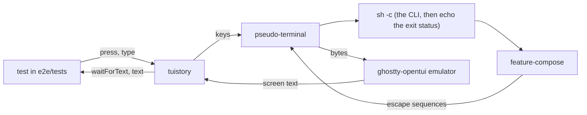
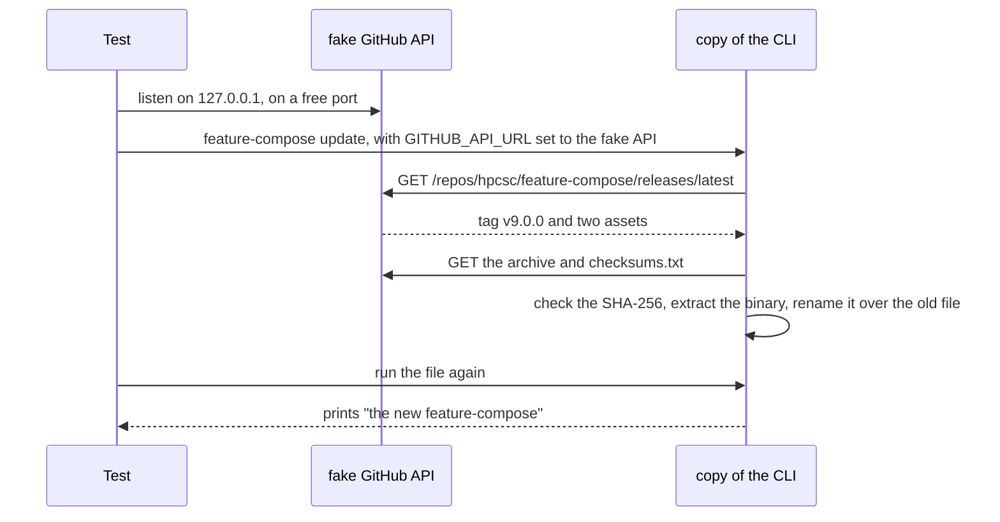
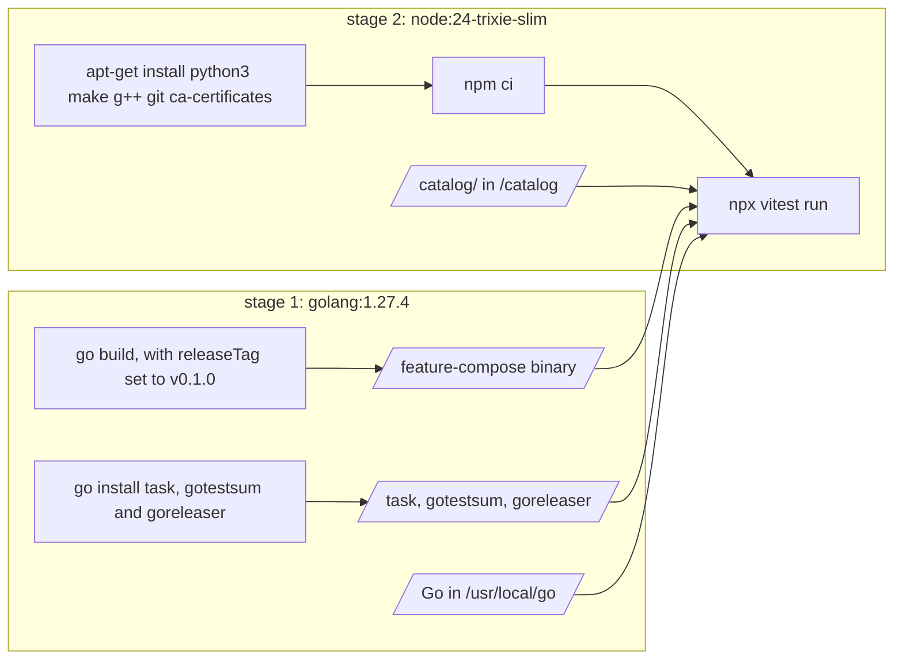

# How the end-to-end tests work

The end-to-end tests run the feature-compose binary in a terminal, send keys to it, and read the
screen. They find faults that the Go tests cannot find: the real terminal output, files on disk, and
exit codes.

The tests are in `e2e/`. `e2e/testUtils.ts` has the helpers, and `e2e/tests/` has the tests.

## Parts

| Part | Job |
| --- | --- |
| vitest | Finds and runs the tests in `e2e/tests/`. |
| tuistory | Starts a program in a pseudo-terminal, sends keys to it, and gives its screen as text. |
| node-pty | Makes the pseudo-terminal for tuistory. |
| ghostty-opentui | The terminal emulator in tuistory. It turns the output of the CLI into a screen of text. |
| `testUtils.ts` | Makes throwaway folders, starts the CLI, and deletes the folders after each test. |

## Plain commands and screen tests

Two helpers start the CLI:

| Helper | Use for | How it works |
| --- | --- | --- |
| `runCli(cwd, args, env)` | Commands that print and stop, such as `version` and `update` | Starts the CLI as a child process with pipes. It gives stdout, stderr and the exit status. |
| `openCli(cwd, args, env)` | The screen, and commands that ask for input | Starts `sh -c 'printf "\033[20l"; <env> <cli> <args>; echo "EXIT:$?"'` in a pseudo-terminal. When the CLI stops, the shell writes its exit status on the screen, so a test can wait for `EXIT:0`. [New line mode](#new-line-mode) tells why the command starts with `printf`. |

`runCli` does not block. The update tests run a fake server in the test process, and that server must
answer while the CLI waits for it.

`runProgram(cwd, program, args, env)` runs any program, for example `task`, and `runCli` runs the CLI with it.

## New line mode

The emulator in tuistory starts in new line mode. In that mode, a line feed moves the cursor to the next
line and also back to column 1. A real terminal starts with the mode off, so a line feed keeps the column.

A full screen program, such as a Bubble Tea one, draws only the cells that change. It moves the cursor
down with a line feed and expects the column to stay the same. In new line mode, the text then goes to the
wrong column.

So `openCli` writes `\e[20l`, which turns new line mode off, before it starts the CLI.

## The update tests

The update tests start a fake GitHub API in the test process and point the CLI at it with
`GITHUB_API_URL`. The fake release holds an archive for the platform of the test and a `checksums.txt`.
The "new binary" in the archive is a shell script, so the test can see that the update replaced the file.

Each update test runs a copy of the CLI in its own folder. The update replaces that copy, so the other
tests keep the original binary.

## The catalog tests

`e2e/tests/catalog.test.ts` makes a git repo with a catalog in a throwaway folder, and gives `catalog add` its
`file://` URL. Each test has its own `XDG_CONFIG_HOME` and `XDG_DATA_HOME`, so the config file and the clones are in
throwaway folders too. The git commands of a test run with `GIT_CONFIG_GLOBAL=/dev/null`, `GIT_CONFIG_NOSYSTEM=1`
and `XDG_CONFIG_HOME=/dev/null`, so the git config of the machine does not change the repo of the test.

Two tests start the CLI in the pseudo-terminal, where git and ssh have a terminal that they can ask on. In the first
test, the source is on a local HTTP server that asks for a password, and the test passes only when the CLI stops at
once, with no question. In the second test, `GIT_SSH_COMMAND` names a script that writes whether it can open
`/dev/tty`, and the test passes only when it cannot.

## The full run of `new`

Fifteen tests in `e2e/tests/new.test.ts` make a repo and check it. Two make a repo from the starter `go`. The
first makes the repo from the starter alone:

1. `feature-compose new go my-tool --no-prompt` makes the repo. Its `after_render` commands run `go mod tidy`,
   which downloads the modules of the repo.
2. `gofmt -l .` lists no file, and `go build ./...` builds.
3. `task test:unit` stops with the exit status 0, and the output of gotestsum shows that the tests of the example
   package `internal/greeting` ran and passed.
4. `task --list-all` names each task that `.github/workflows/ci.yml` and `scripts/libs/git-hook-prepush.sh` of the
   repo call. The test takes the names from the two files. It names no task `build`, `cli`, `release:local`,
   `test:e2e` or `test:e2e:local`, because these tasks come from `cli`.

The second adds `--feature cli`, and makes a CLI in its own repo:

1. The `go.mod` of the repo, after `go mod tidy`, gives each module of the items of `gomod.requires` of `cli`
   the version of the item. The test takes the items from the JSON of `show`. A second `new` of the same repo
   into another folder, with `GOPROXY=off` and `GOSUMDB=off`, stops with the exit status 0 and writes the same
   `go.mod`. With no proxy, `go mod tidy` reads only the module cache, which the first `new` filled, and it
   stops when an import needs a lookup of a latest version.
2. `gofmt -l .` lists no file, and `go build ./...` builds.
3. `task test:unit` stops with the exit status 0. The output of gotestsum shows that the tests of
   `internal/greeting` and of each package under `internal/cli` that has a test file ran and passed.
4. `task build` builds `bin/my-tool`. With no command, it prints the commands of the CLI, which are only
   `version`, `update` and `help`. `task cli -- --help` runs the CLI from the source and prints the same
   commands.
5. `task --list-all` names each task that the `docs/cli.md` of the repo names, and the doc names `build`, `cli`,
   `release:local`, `test:e2e` and `test:e2e:local`. It also names each task that `.github/workflows/ci.yml`
   calls, `test:unit` and `test:e2e` among them, so the job `e2e` of `cli` calls a task that the repo has.
6. `task test:e2e:local` builds the CLI with the tag `v0.1.0`, installs the packages of `e2e/` with npm, and
   runs the end-to-end tests of the repo with vitest. It stops with the exit status 0, and its output shows
   each test file in `e2e/tests` of the repo as passed. The test takes the names from the folder.
7. `task release:local` makes a GoReleaser snapshot of the repo. For each `goos` and `goarch` of the
   `.goreleaser.yaml` of the repo, `dist/` has the archive `my-tool-<goos>-<goarch>.tar.gz`, the name that
   `update` and `scripts/install.sh` download. `dist/checksums.txt` has the SHA-256 of each archive, which the
   test calculates from the file.
8. The binary in the archive for the platform of the test prints the tag of the snapshot for `version`. So the
   ldflag of `.goreleaser.yaml` sets the version.
9. The test runs `git init` in the repo. `git status --porcelain --untracked-files=all` lists `go.mod`, and no
   path under `dist/` or `e2e/node_modules/`, which the snapshot and the `npm install` of step 6 made. So the
   `.gitignore` of the repo has the patterns of `cli`.

Five make a repo from the starter `chi-api`. The first makes the repo from the starter alone:

1. `feature-compose new chi-api my-api --no-prompt` makes the repo. Its `after_render` commands run
   `go mod tidy`, which downloads the modules of the repo.
2. `gofmt -l .` lists no file, and `go build ./...` builds.
3. `task test:unit` stops with the exit status 0, and the output of gotestsum shows that the tests of each package
   under `internal` that has a test file ran and passed. The test takes the packages from the folders of the
   repo.
4. `task --list-all` names `api:run`, and each task that `.github/workflows/ci.yml` and
   `scripts/libs/git-hook-prepush.sh` of the repo call. It names no task `build`, `cli`, `release:local`,
   `test:e2e` or `test:e2e:local`, because these tasks come from `cli`.
5. The test starts the API of the repo. `GET /api/` gets 200, and `POST /api/users` with the body `{}` and no
   `Authorization` header gets the answer 400 of the handler. The API of a repo without `api-auth` accepts each
   request. Each route of the API is under `/api`, so `POST /users` gets 404.

The second adds `--feature api-auth`, and checks the API key with the routes of `chi-api`:

1. `gofmt -l .` lists no file, `go build ./...` builds, and `task test:unit` stops with the exit status 0.
   The output of gotestsum shows that the tests of `internal/auth`, of `internal/use_cases` and of
   `internal/use_cases/user` ran and passed.
2. The test starts the API with `API_KEY_HASHES` set to the SHA-256 hash of a key of the test. `GET /api/`
   gets 200 with no key. `POST /api/users` gets 401 with `WWW-Authenticate: Bearer` with no `Authorization`
   header and with an unknown key, and it gets the answer 400 of the handler with the key of the test. The
   body of the 401 is JSON with the keys of the error of the handler, `successful` false, and a message that
   tells the client to sign in. So the server of `chi-api` gives the item of `api-auth` to the protected
   routes.
3. The test makes a second repo from `chi-api` alone. The `go.mod` of the two repos is the same.

The third adds `--feature api-auth:method=oauth`. The test starts a test issuer, as the run of
`go-event-sourcing-service` with the method `oauth` does, and the API with `OAUTH_AUDIENCE` set to `my-api`.
`POST /api/users` gets 401 with `WWW-Authenticate: Bearer` with no `Authorization` header and with a token for
another audience, and it gets the answer 400 of the handler with a token for `my-api`.

The fourth adds `--feature cli`, and checks that the feature fits the starter:

1. `gofmt -l .` lists no file, and `go build ./...` builds the API and the CLI.
2. `task test:unit` stops with the exit status 0. The output of gotestsum shows that the tests of the CLI
   under `internal/cli` and of the API ran and passed.
3. `task build` builds `bin/my-api`, and `task cli -- --help` runs the CLI from the source. Each prints only
   the commands `version`, `update` and `help`.
4. `task --dry api:run` prints `go run ./cmd/api`. So the task of the API stays the task of the starter.
5. `task --list-all` names each task that `.github/workflows/ci.yml` calls, `test:unit` and `test:e2e` among
   them. So the job `e2e` of `cli` calls a task that the repo has.

The fifth adds only `--feature cli-auth`, which needs `cli` and `api-auth`:

1. The output names `api-auth` and `cli` as needed by `cli-auth`, and `chi-api` as the starter.
2. `go.mod` holds no module of the items of `gomod.requires` of `cli-auth`, because only the files of the
   method `oauth` and of the stored key import them.
3. `gofmt -l .` lists no file, the CLI builds, and `task test:unit` stops with the exit status 0. The tests of
   `internal/credential`, `internal/apiclient`, `internal/auth` and `internal/cli` ran and passed.
4. The test starts the API with `API_KEY_HASHES` of a key of the test, and builds a program that calls
   `POST /users` of the API through `internal/apiclient` of the repo. With the key in `MY_API_API_KEY`, the
   call gets the answer 400 of the handler. With an unknown key, it stops with the message of a refused key,
   and with no key, it stops with the message of no key.

The other eight make a repo from `go-event-sourcing-service`. The first makes the repo from the starter alone:

1. `feature-compose new go-event-sourcing-service my-service --no-prompt` makes the repo. Its `after_render`
   commands run `go mod tidy`, which downloads the modules of the repo.
2. `gofmt -l .` lists no file.
3. `task --list-all` names `run`, and no task `build`, `cli` or `release:local`. `task test:unit` stops with
   the exit status 0. It runs gotestsum, and gotestsum runs `go test -race`, which needs a C compiler.
4. The test starts the API of the repo. `GET /api/` gets 200, and `POST /api/accounts` with no `Authorization`
   header gets the answer 400 of the handler. The API of a repo without `api-auth` accepts each request. Each
   route of the API is under `/api`, so `POST /accounts` gets 404.
5. With no `ALLOWED_ORIGINS`, and with `ALLOWED_ORIGINS` set to the empty text, a request from
   `http://localhost:8080` and from `http://127.0.0.1:8080` gets its origin in
   `Access-Control-Allow-Origin`, and a request from another origin gets none. With
   `ALLOWED_ORIGINS=https://app.example.com, http://localhost:3000`, each of the two origins gets it, and
   `http://localhost:8080` gets none.

The second adds `--feature api-auth`, and checks the API key:

1. `gofmt -l .` lists no file, `go build ./...` builds, and `task test:unit` stops with the exit status 0.
   The output of gotestsum shows that the tests of `internal/auth` and of the service ran and passed.
2. The test starts the API with `API_KEY_HASHES` set to the SHA-256 hash of a key of the test. `GET /api/`
   gets 200 with no key. `POST /api/accounts` gets 401 with `WWW-Authenticate: Bearer` with no `Authorization`
   header and with an unknown key, and it gets the answer 400 of the handler with the key of the test. The
   body of the 401 is JSON with the keys of the error of the handler, `successful` false, and a message that
   tells the client to sign in.
   From `http://localhost:8080`, the preflight of `POST /api/accounts` that asks for the headers
   `authorization` and `content-type` gets 204 with the origin and the two headers allowed, and the `POST`
   with no key gets 401 with the origin in `Access-Control-Allow-Origin`. The same requests from another
   origin get no `Access-Control-Allow-Origin`.
3. The test makes a second repo from the starter alone. The `go.mod` of the two repos is the same, so the
   method `api-key` adds no module, and no JWT library.

The next adds `--feature api-auth:method=oauth`, and checks the access tokens:

1. `gofmt -l .` lists no file, `go build ./...` builds, and `task test:unit` stops with the exit status 0.
   The tests of `internal/auth` ran and passed. They check the access tokens against a test issuer of their
   own.
2. The test starts a test issuer on `127.0.0.1`. It serves OpenID Connect discovery and one signing key, and
   it signs access tokens with RS256 and that key.
3. The test starts the API with `OAUTH_ISSUER_URL` set to the test issuer and `OAUTH_AUDIENCE` set to
   `my-api`. `GET /api/` gets 200 with no token. `POST /api/accounts` gets 401 with
   `WWW-Authenticate: Bearer` with no `Authorization` header, with a token for another audience, and with a
   token whose `exp` is before now. It gets the answer 400 of the handler with a token for `my-api`. The body
   of the 401 is JSON with the keys of the error of the handler, `successful` false, and a message that tells
   the client to sign in.
4. The test starts the API again with `OAUTH_AUDIENCE` set to `another-api`, with no new render. The token for
   `my-api` now gets 401, and a token for `another-api` gets 400.

The next adds `--feature cli`, and checks that the feature fits the starter:

1. `gofmt -l .` lists no file, and `go build ./...` builds the service and the CLI.
2. `task test:unit` stops with the exit status 0. The output of gotestsum shows that the tests of the CLI
   under `internal/cli` and of the service ran and passed. A package whose tests the build tags exclude does
   not count.
3. `task build` builds `bin/my-service`. With no command, it prints the commands of the CLI, which are only
   `version`, `update` and `help`, and reads no input. `task cli -- --help` runs the CLI from the source and
   prints the same commands.
4. `task --dry run` prints the `tmuxp load` of the starter. So `task run` still starts the service, and the
   tasks of `cli` keep names that the starter does not use.
5. `task --list-all` names each task that `.github/workflows/ci.yml` calls, `test:unit` and `test:e2e` among
   them.

The next adds only `--feature cli-auth`, which needs `cli` and `api-auth`:

1. `new` prints `api-auth: needed by cli-auth` and `cli: needed by cli-auth` before the line that names the
   output folder.
2. `gofmt -l .` lists no file, and the CLI builds. `task test:unit` stops with the exit status 0, and the
   tests of `internal/credential`, `internal/apiclient`, `internal/auth`, `internal/cli` and of the service ran
   and passed. The tests of `internal/apiclient` call a test server behind `auth.Middleware` of the repo.
3. The CLI lists the commands `version`, `update`, `auth` and `help`. With `MY_SERVICE_API_KEY` set,
   `auth status` names the variable and does not print the key. With no variable and an empty config folder,
   it stops with an exit status other than 0, and its message names `MY_SERVICE_API_KEY` and
   `credentialCommand`.
4. The test starts the API with the hash of a key of the test, and builds a program that calls
   `apiclient.New` with the base URL of the API, which ends with `/api`, and `Do` with `POST /accounts`. With
   the key of the test, the program prints the answer 400 of the handler. With an unknown key and with no key,
   it stops with the messages of the CLI.
5. The `go.mod` of the repo requires none of the modules that `show` lists in the `gomod.requires` of `cli-auth`: the
   modules of the method `oauth` and of the stored key.

The next adds `--feature cli-auth:store-key=true`, so the CLI keeps its API key in the OS credential store:

1. `.feature-compose.yml` holds `store-key: "true"`. The `go.mod` of the repo requires `github.com/zalando/go-keyring`
   and `golang.org/x/term` at the versions of their items, and no other module of the `gomod.requires` of `cli-auth`.
2. `gofmt -l .` lists no file, and the CLI builds. `task test:unit` stops with the exit status 0, and the tests of
   `internal/credential`, `internal/apiclient`, `internal/auth` and `internal/cli` ran and passed.
   `task test:e2e:local` of the repo passes, with `tests/auth.test.ts` among the files that passed.
3. The test starts the API with the hash of a key of the test. `auth login` of the built CLI reads the key on stdin,
   with the API URL of the API and `MY_SERVICE_CREDENTIAL_STORE=file`. The program of the test then calls
   `POST /api/accounts` with no `MY_SERVICE_API_KEY` and prints the answer 400 of the handler, so the API accepted
   the stored key. With `MY_SERVICE_API_KEY` of an unknown key, the call stops with a message that names the
   variable, so the variable still comes first. After `auth logout`, the call stops, and the message tells the user
   to run `my-service auth login`.

The next adds `--feature cli-auth --feature api-auth:method=oauth`, so the CLI logs in at an issuer:

1. `new` prints `cli: needed by cli-auth`, and `.feature-compose.yml` holds `api-auth` with `method: oauth`.
2. `gofmt -l .` lists no file, and the CLI builds. `task test:unit` stops with the exit status 0, and the
   tests of `internal/credential`, `internal/apiclient`, `internal/auth` and `internal/cli` ran and passed.
   The `go.mod` of the repo requires `golang.org/x/oauth2`, `github.com/zalando/go-keyring` and
   `github.com/cli/browser` at the versions of their items of `gomod.requires`, and not `golang.org/x/term`, which only
   the files of the stored key import.
3. `task test:e2e:local` of the repo stops with the exit status 0, with `tests/auth.test.ts` among the files that
   passed. These tests run `auth status`, `auth login`, `auth token` and `auth logout` against a test issuer of
   their own.
4. The test starts a test issuer on `127.0.0.1`. It serves OpenID Connect discovery, one signing key, the device
   authorization endpoint and the token endpoint. It signs RS256 access tokens for the audience of the device
   authorization request, and a refresh keeps that audience. The test starts the API with `OAUTH_ISSUER_URL`
   set to the test issuer and `OAUTH_AUDIENCE` set to `my-api`.
5. The built CLI runs `auth login --device` with `MY_SERVICE_OAUTH_AUDIENCE=my-api`, the API URL of the API, and
   `MY_SERVICE_CREDENTIAL_STORE=file` in an empty config folder. The test issuer gets the audience `my-api`. The
   program of the test calls `POST /api/accounts` through `apiclient.Do` and prints the answer 400 of the
   handler, so the API accepted the token that the CLI got.
6. After a login whose access token expires, the call refreshes the token at the test issuer, and the API
   accepts the new token. When the test issuer refuses the refresh, the call stops, and the message tells the
   user to run `my-service auth login`.
7. With `MY_SERVICE_OAUTH_AUDIENCE=another-api`, the same binary logs in for `another-api`, and the API refuses
   the token. So the CLI changes its audience with no new render.

The next adds `--feature process-manager`, the example of a payment to another bank:

1. `gofmt -l .` lists no file, `go build ./...` builds, and `go vet -tags integration ./...` compiles the
   integration tests, `process_test.go` among them. The test does not run them: they need Postgres.
2. `task test:unit` stops with the exit status 0. The output of gotestsum shows that the tests of each package
   with unit tests under `internal/use_cases`, `internal/api/use_cases` and `cmd/catchup` ran and passed.
   These packages include the files that connect the example to the service, and the fakes of the outside
   systems in `checks`, `submission` and `outside`.
3. `task --list-all` names `run`, `fake_services:run`, `api:pay` and `api:get-payment`.
4. The test starts the API. `POST /api/payments` and `POST /api/webhooks/fraud-checks` with the body `{}` get
   the answer 400 of their handlers, and `POST /payments` gets 404.
5. The test starts a webhook server of its own, and builds and starts `./cmd/fake_services` of the repo on a
   free port with `WEBHOOK_DELAY=0s`. `POST /fraud/checks` with an `Idempotency-Key`, an amount under the
   limit and the URL of the webhook server gets 202. The webhook server then gets one webhook with the
   payment ID, `passed` true and the same key.

The next adds `--feature push`, which sends each new event of the service to the WebSocket clients of the API:

1. `gofmt -l .` lists no file, `go build ./...` builds, and `go vet -tags integration ./...` compiles the
   integration tests of `internal/api/push` and `internal/api/use_cases`.
2. `task test:unit` stops with the exit status 0. The output of gotestsum shows that the tests of
   `internal/api/push` and `internal/api/server` ran and passed.
3. The test starts the API with the database settings that point to no database. The push worker of the API
   cannot read its checkpoint, so the API stops with the exit status 1, and its output names the worker `push`
   and the error.

The last adds `--feature push:delivery=nats`, so catchup publishes the events to NATS:

1. `gofmt -l .` lists no file, `go build ./...` builds, and `go vet -tags integration ./...` compiles the
   integration tests of `cmd/catchup` and `internal/api/use_cases`, which need NATS.
2. `task test:unit` stops with the exit status 0. The output of gotestsum shows that the tests of
   `internal/api/push` and `internal/api/server` ran and passed.
3. `task --list-all` names `run` and `run-dependencies`, which start NATS beside Postgres.

The test does not run `task run`, the migrations or the integration tests. They need Docker and Postgres.
The CI of the written repo runs the integration tests.

To start an API, a test builds `./cmd/api` of the repo and runs it on a free port of `127.0.0.1`. The test
calls the API at its base URL, which ends with `/api`. Its database settings point to no database. The pool of
the API opens no connection before the first query, and `POST /api/accounts` with the body `{}` stops in the
handler, because the owner is missing, before any query. So the test needs no Postgres. The API, the fakes
and the webhook server stop when the test ends.

So these tests need Go, Task, gotestsum, a C compiler and the network. The test of `go` with `cli` also needs
Node with npm, GoReleaser and git: GoReleaser stops when no `git` is on the `PATH`, also outside a git repository. Each takes about a minute when the Go
module cache has the modules of the new repo, and some minutes when it does not, for example in Docker.
They are the only tests with a timeout longer than the 30 seconds of `e2e/vitest.config.ts`: their timeout
is 15 minutes.

The new repo has its own `mise.toml`. On a machine where `go` or `task` runs through a mise shim, mise
refuses a config that nobody trusted. The test sets `MISE_TRUSTED_CONFIG_PATHS` to its scratch folder, so
mise trusts the new repo.

## Where the tests run

| Command | Where | What it needs |
| --- | --- | --- |
| `task test:e2e` | Docker | Docker and the network. CI runs this command. |
| `task test:e2e:local` | This machine | Node, Go, Task, gotestsum, GoReleaser, git, a C compiler and the network |

Both commands build the CLI with the tag in `E2E_TAG` in `Taskfile.test.yml`, which is `v0.1.0`. They set
three environment variables for the tests: `EXECUTABLE`, the path of the binary, `BUILD_TAG`, the tag, and
`CATALOG_DIR`, the catalog folder of this repo. The `version` and `update` tests compare the output of the
CLI with `BUILD_TAG`. `runCli` and `openCli` give the CLI a config file with the catalog `hpcsc` from the folder `CATALOG_DIR`,
through `XDG_CONFIG_HOME`. So the starters and the features have full names such as `hpcsc/go`. A test can give
another `XDG_CONFIG_HOME` in its `env`, for example the folder of `configHomeWith`, which writes a config file
with other catalogs.

No feature of the catalog of this repo sets a value in a need. So the tests of a need value, the source
`need of <features>`, the stop of a flag against a need and the text `from the need of <features>` in the form,
write a catalog to a scratch folder: a starter `service`, a feature `auth` with the option `method`, and a feature
`client` whose need sets `method: api-key`. `needValueHome` gives them a config folder that names that catalog.

The Docker image has two stages:

`python3`, `make` and `g++` let npm build node-pty when no prebuilt node-pty fits the platform. `g++` also
brings `gcc`, the C compiler that `go test -race` needs, and GoReleaser needs `git`. `go mod tidy` of a new repo
needs `ca-certificates` to trust the TLS certificate of the Go module proxy. The runner stage copies Go,
Task, gotestsum and GoReleaser from stage 1 for [the full run of `new`](#the-full-run-of-new). The image runs `npm ci` when
`e2e/package-lock.json` is in the repository, and `npm install` when it is not. Commit the lock file, so
every run installs the same packages.

In GitHub Actions, the `e2e` job in `.github/workflows/ci.yml` runs `task test:e2e` on `ubuntu-latest`,
which has Docker. The release workflow calls the CI workflow, so a release waits for these tests too.

## How to write a new test

1. Make a folder with `scratchDir()`.
2. Start the CLI with `openCli(dir)`, or with `runCli(dir, args)` when the command prints and stops.
3. Wait for text that shows that the screen is ready, for example `Name:`.
4. Send keys with `press`. Use `type` for text and for capital letters, because the key names in tuistory
   have lower case letters only.
5. Wait for the text that proves the result. Then check the rest of the screen with `expect`.

Keep these rules:

- **Wait for the text that you check, not for a title:** a program that loads in the background can show a
  title before its content.
- **Give each test its own folder:** `scratchDir()` makes the folder, and `onTestFinished` deletes it.
- **Wait 15 seconds for the first text:** tuistory starts each command about 5 seconds late, so the first
  `waitForText` of a screen test passes `{ timeout: 15_000 }`.
- **Do not change the terminal size:** `openCli` uses 160 columns and 40 rows, and the tests expect text
  that fits that size. A test that reads the whole tree of `show` gives `openCli` 73 rows, because each
  extension point of each starter and the catalog have a line of their own, and the tree does not fit on 40 rows.
