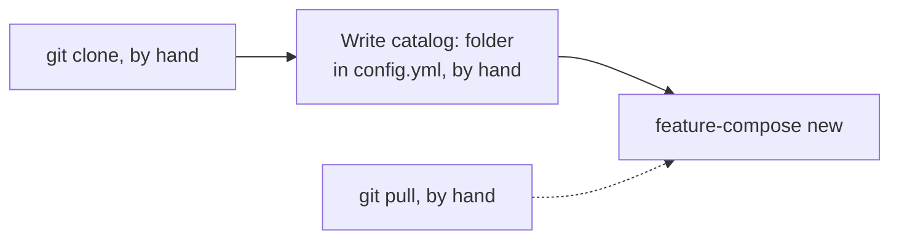
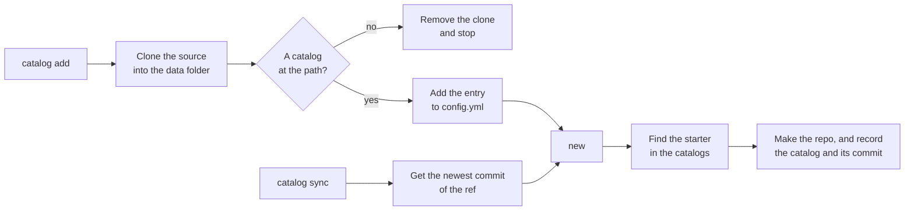
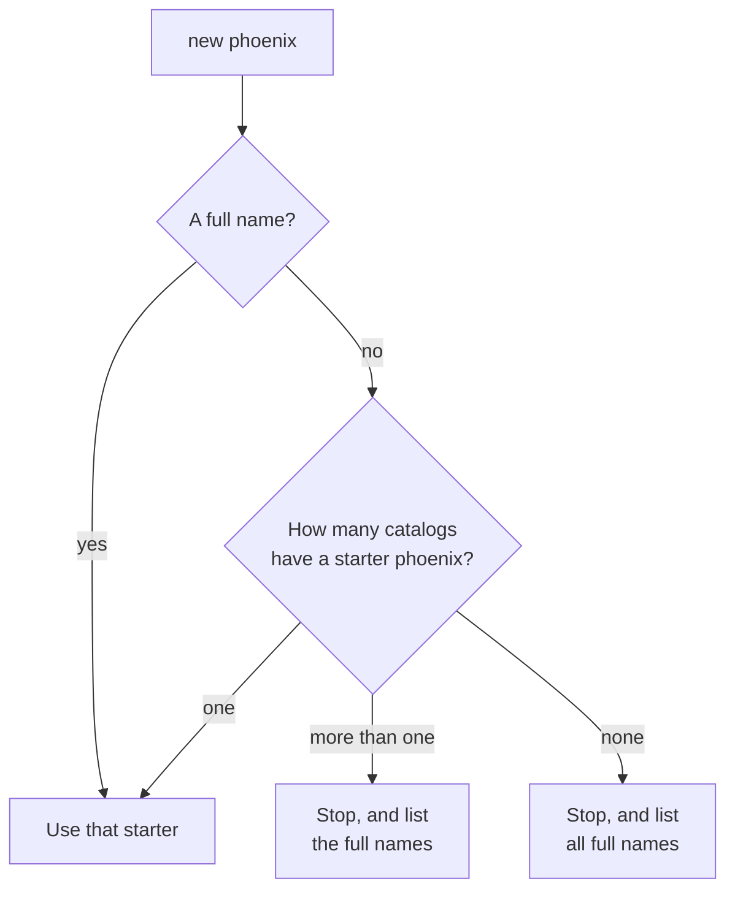

# Catalog Registry

A user gets each catalog with one command, keeps more than one catalog, and makes a repo from a starter of any
of them.

## The Problem

Now a user gets a catalog in three steps:

1. Clone the repo of the catalog by hand.
2. Write `catalog: <folder>` in `~/.config/feature-compose/config.yml`.
3. Pull the clone by hand when the catalog changes.

The tool knows one catalog at a time. A second catalog needs `--catalog <folder>` on each command. A repo
records the name of its starter, but not the catalog or the version of the catalog that made it.

## Goals

- **G1:** A user gets a catalog from a git repo or from a local folder with one command, with no clone by hand
  and no config file to write.
- **G2:** A user keeps more than one catalog, and makes a repo from a starter of any of them.
- **G3:** A user gets the newest content of a catalog with one command, and sees which commit it got.
- **G4:** A user removes a catalog, or changes its version or its folder, with one command.
- **G5:** A user can make the same repo again later, because the repo records its catalog, the source of the
  catalog and its commit.
- **G6:** A user gets a catalog from a private repo with the credentials that git already has.
- **G7:** A user sees the starters and the features of each catalog in a group of their own in `show`.
- **G8:** A user adds a known catalog by its name, with no URL.
- **G9:** CI gets a catalog from a private GitHub repo with a token.
- **G10:** A user sees each command that a catalog will run, before `new` runs it.

## The Flow Now



## The Proposed Flow

```shell
feature-compose catalog add hpcsc https://github.com/hpcsc/feature-compose --path catalog
feature-compose new phoenix my-app --feature oban
```



### The Commands

| Command | What it does |
| --- | --- |
| `catalog add <name> <source> [--path <folder>] [--ref <ref>]` | Gets the catalog and adds it to the config |
| `catalog list` | Shows the name, the source, the path, the ref and the commit of each catalog |
| `catalog sync [<name>…]` | Gets the newest commit of the ref of each catalog, or of the named ones, and shows the old and the new commit |
| `catalog remove <name>` | Removes the catalog from the config, and deletes its clone |
| `catalog set <name> [--path <folder>] [--ref <ref>]` | Changes the path or the ref of a catalog, and gets the commit of the new ref |

### Sources

| Source | Example | What the tool does |
| --- | --- | --- |
| A git URL | `https://github.com/hpcsc/feature-compose`, `git@github.com:team/catalog.git` | Clones the repo into the data folder of the tool, and checks out the ref |
| A local folder | `~/code/team-catalog` | Uses the folder where it is, and records its full path. `sync` does nothing for it |

- `--path` names the folder of the catalog in the source, for example `catalog` for this repo. With no `--path`,
  the catalog is at the root of the source.
- `--ref` names a tag, a branch or a commit. With no `--ref`, the tool uses the default branch of the repo.
- A branch gets its newest commit at each `sync`. A tag or a commit stays at the same content.

### Names Across Catalogs

Each catalog in the config has a name. Its starters have full names, for example `hpcsc/phoenix`.



- A repo takes its features only from the catalog of its starter. So `--feature oban` means the feature `oban` of
  that catalog.
- A catalog from `--catalog <folder>` has no name, so its starters keep their short names. CI checks the catalog
  of this repo in this way.
- `--catalog` also takes the name of a catalog in the config. Then the command reads only that catalog.

### What a Repo Records

`.feature-compose.yml` records the catalog of the repo:

```yaml
version: v0.4.0
catalog:
  name: hpcsc
  source: https://github.com/hpcsc/feature-compose
  path: catalog
  ref: main
  commit: 2868ee8c1f0e4b6a9d3e2f7a5b1c0d9e8f7a6b5c
starter: phoenix
name: my-app
```

The command that makes the same repo again names the full starter, for example
`feature-compose new hpcsc/phoenix my-app --feature oban`.

### Private Repos

git reads a private repo with the credentials that it already has: an SSH key, or a credential helper for HTTPS.
If `git clone <source>` works on the machine, `catalog add` works too.

The tool turns off the questions of git and of SSH. So when a credential is not there, git stops at once, and the tool
says: "git cannot read <source>: check that `git clone <source>` works". Without this, git waits for a password
that nobody sees.

### Trust

A catalog runs its commands on the machine of the user: the `generate` command and the `after_render` commands
of its starters. So a user who adds a catalog trusts its owner.

- `catalog add` says that the catalog can run commands, and names the source.
- The preview of `new` lists each command that `new` will run: the `generate` command and each `after_render`
  command of each folder, in the order in which `new` runs them.
- `new` never gets new content. Only `catalog sync` does, so a catalog cannot change between two runs of `new`.

### Phase 2

- **Known catalogs (G8).** The file `catalogs.yml` in this repo is an index of known catalogs: a name, a summary,
  a source and a path for each. `catalog add hpcsc` with no source gets the catalog of that name from the index.
  `catalog list --known` lists the index. The tool gets the index from GitHub each time, so a new entry needs no
  release of the tool.
- **CI with a token (G9).** When `GITHUB_TOKEN` or `GH_TOKEN` is set, git gets the token for each source on the
  GitHub server. So CI gets a catalog from a private repo with no SSH key. A source on another server does not get
  the token.
- **show by catalog (G7).** The tree of `show` has a row for each catalog, with its starters under it. In a
  catalog, the starters and the features have the names that the catalog gives them. The JSON keeps the full names.

## Edge Cases

| Case | What happens |
| --- | --- |
| `catalog add` with a name that the config already has | It stops. The message names `catalog set` and `catalog remove` |
| A source that git cannot read | `catalog add` stops. The config gets no entry, and no clone stays |
| A source with no catalog at its path | `catalog add` removes the clone and stops. The message names `--path` |
| A ref that the repo does not have | `catalog add` or `catalog set` stops, and the entry stays as it was |
| The clone is gone, for example after a clean of the data folder | `new` stops and names `catalog sync`. `catalog sync` clones the source again |
| A catalog that the user removes after a repo was made | The repo does not change. Its `.feature-compose.yml` still names the catalog |
| `add starter` or `add feature` for a catalog from a git URL | It stops, because the next `sync` removes the change. A change goes to the repo of the catalog, or to a catalog from a local folder |
| A config file with the old key `catalog:` | The tool stops. The message tells the user to run `catalog add` |
| No network | `new` works from the clones. `catalog add` and `catalog sync` stop with the message of git |

## Decisions

The implementation notes hold the decision ledger D1 to D19, with the reason for each decision. These are the
decisions that change what a user sees:

- git, not the GitHub API, gets each catalog (D1).
- A repo takes its features only from the catalog of its starter (D3).
- The subcommands are `add`, `list`, `sync`, `remove` and `set` (D4).
- `new` gives no warning for a catalog that is old (D5), and it never gets new content (D13).
- The key `catalog:` goes away, and the config holds only named catalogs (D6).
- A starter has a full name, and a short name works while it is unique (D7).
- `catalog add` checks only that the path holds a catalog (D14).
- The preview of `new` lists each command that `new` will run (D16).
- The index of known catalogs is a file in this repo, and the tool gets it from GitHub (D17).
- git gets a GitHub token in CI through its environment, only for the GitHub server (D18).
- The tree of `show` groups the starters by catalog, and the JSON keeps the full names (D19).

## Rollout

| Phase | Goals | Content |
| --- | --- | --- |
| 1 | G1 to G6, G10 | git and local sources, the five subcommands, full names, the catalog in `.feature-compose.yml`, the commands in the preview |
| 2 | G7 to G9 | `show` by catalog, a central index of known catalogs, a token for git in CI |

## Measures

- The Get Started section of the README makes a first repo with two commands, `catalog add` and `new`, and has no
  step that writes the config file.
- The e2e tests add a catalog from a git repo, sync it to a new commit, and make a repo from it.

## Definition of Done for Phase 1

- **G1:** `catalog add` with a git URL, and with a local folder, writes the entry. The README has no step that
  writes the config file.
- **G2:** With two catalogs in the config, `new` makes a repo from a starter of each. A short name that two
  catalogs share stops `new` with the full names.
- **G3:** `catalog sync` gets a new commit of a branch, and shows the old and the new commit.
- **G4:** `catalog remove` deletes the entry and the clone. `catalog set --ref` checks out the new ref.
- **G5:** `.feature-compose.yml` holds the catalog block. The command that makes the same repo again names the
  full starter.
- **G6:** `catalog add` gets a private repo over SSH with no other setup. A source with no credential stops at
  once with the message about `git clone`.
- **G10:** The preview of `new` lists the `generate` command and each `after_render` command of each folder, in
  the order in which `new` runs them.

## Definition of Done for Phase 2

- **G7:** With two catalogs, the tree of `show` has a row for each catalog, with its starters under it and the
  names that the catalog gives them.
- **G8:** `catalog add hpcsc` with no source gets the catalog from the index. `catalog list --known` lists the
  known catalogs.
- **G9:** With `GITHUB_TOKEN`, `catalog add` gets a private repo on the GitHub server over HTTPS. A source on
  another server does not get the token.
