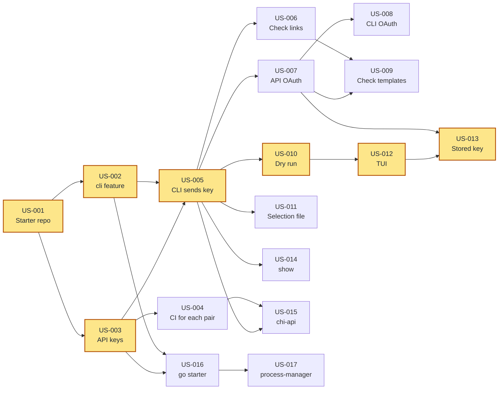

# feature-compose

**Proposal:** `PROPOSAL.md`

## Overview

feature-compose makes a new repo from one starter and the features that you select. Scaffold renders one
template at a time, so two templates that must agree, for example the CLI and the API of one repo, can get
different methods of authentication. feature-compose adds the needs of each feature, asks each question one
time, and renders all files in one pass.

These stories cover phases 1 and 2 of the proposal:

- The commands `new`, `show`, and `check`, the TUIs of `new` and `show`, and the CI job that tests each
  starter with each feature
- The starters `go-event-sourcing-service`, `chi-api`, and `go`
- The features `cli`, `api-auth`, `cli-auth`, and `process-manager`

The stories have two kinds of user:

- A **developer** makes a repo with `new`.
- A **catalog author** writes starters and features, and keeps `check` and CI green.

## Goals

The goals are G1 to G7 in [the proposal](../PROPOSAL.md): needs that the tool selects, one question for each
option, one feature for many starters, one render with no hooks, more than one language in a feature, a
check of the catalog in CI, and a record of the selection in the repo.

## Delivery Order

All stories start from US-001. US-005 is the bottleneck: six stories wait for it, because it is the first
story with a need, and those stories show, check, record, or ask about needs.

The critical path is six stories deep: US-001, then US-002 or US-003, then US-005, US-010, US-012, and
US-013. Build US-002 and US-003 at the same time, and start the TUI (US-010, then US-012) soon after US-005.

## User Stories

### US-001: Make a repo from the go-event-sourcing-service starter

**Goals:** G4

**Description:** As a developer, I want to make a new repo from the starter `go-event-sourcing-service` with
one command, so that I get a service that builds and passes its tests without scaffold.

**Acceptance Criteria:**

- [ ] `feature-compose new go-event-sourcing-service my-service --no-prompt` writes the repo to
  `./my-service`, and `task test:unit` passes in that repo.
- [ ] The tool runs from any folder. It needs no catalog files on disk, no `SCAFFOLD_DIR`, and no URL of a
  catalog.
- [ ] The name of the repo appears in the contents and in the paths of the files where the starter uses it.
  The default of the option `module` is `github.com/hpcsc/my-service`.
- [ ] `--option module=<value>` and `--option go-version=<value>` set the options of the starter. An unknown
  starter, an unknown option, or a value that does not match the pattern of its option, for example
  `go-version=1.20`, stops the tool before it writes a file. The message names the option and its pattern,
  or lists the names that the tool knows.
- [ ] The Taskfiles of the repo keep the template syntax of Task, for example `{{ .CLI_ARGS }}`, and
  `task --list` runs in the repo.
- [ ] After the tool renders all files, it runs `go mod tidy` and `gofmt -w .` in the folder `go`. When a
  command fails, the tool stops, and the message names the folder, the command, and the output of the
  command.
- [ ] `--output-dir <path>` writes the repo to that path. When the output folder exists and is not empty,
  the tool stops and writes nothing.

**Context:** The starter is `go-event-sourcing-service` of `repo-templates` without the process manager
(section 16 of the proposal). The starter has no check of the credential of its own. The feature `api-auth`
(US-003) is the only check, and its method `api-key` replaces the shared token of today. So the API of a
repo without `api-auth` accepts each request. `repo-templates` stays until each template that moves has its
replacement, so no developer loses a template that works. This story covers the mode without the TUI, which
CI also uses. US-012 adds the TUI.

### US-002: Add a CLI to a service repo

**Goals:** G1, G5

**Description:** As a developer, I want to add a command line program to my service repo with
`--feature cli`, so that the repo has a CLI with releases, from the same catalog as the service.

**Acceptance Criteria:**

- [ ] `feature-compose new go-event-sourcing-service my-service --feature cli --no-prompt` writes the files
  of the starter and the files of `cli`. The repo builds, and the unit tests of the service and of the CLI
  pass.
- [ ] The files of `cli` use the name of the repo in their contents and in their paths, as the files of the
  starter do.
- [ ] One feature adds files in more than one language: the Go code of the CLI and the config of its
  releases in YAML. The feature names no language.
- [ ] The root command of the CLI shows each command that a feature adds to the extension point
  `cli.commands`. With no such feature, the CLI builds and shows only its own commands.
- [ ] An unknown feature stops the tool before it writes a file, and the message lists the features that
  target the starter.

**Context:** `cli` holds the CLI of the template `go-cli` of `repo-templates`. In scaffold, a global
template sees `.Project` as `templates`, so it cannot use the name of the repo. That is why the files of the
process manager are copies in two templates today. A feature in feature-compose gets the name of the repo,
as a starter does. `cli` declares `cli.commands` in its own file, so a feature that needs `cli` can add a
command. US-016 uses the same files for a CLI in its own repo.

**Depends on:** US-001

### US-003: Protect the API with API keys

**Goals:** G4

**Description:** As a developer, I want to add `--feature api-auth` to my service repo, so that the API
accepts only the requests that carry a valid API key.

**Acceptance Criteria:**

- [ ] A request with no `Authorization` header, or with a key that the API does not know, gets 401 with
  `WWW-Authenticate: Bearer`. A request with `Authorization: Bearer <valid key>` gets to the handler. The API
  answers 403 only for a valid key that has no permission.
- [ ] The API keeps a SHA-256 hash of each key, never the key, and it compares in constant time. The hashes
  come from the config of the repo, so an operator can change the keys without a new render.
- [ ] `api-auth` has the option `method`, with the value `api-key` as its default. `--feature
  api-auth:method=<value>` sets it. A value that the option does not have stops the tool, and the message
  names the option and its values.
- [ ] The server and the config of the starter render the items that `api-auth` adds to the extension
  points `api.middleware` and `api.config`. The repo has no markers, and no step other than the folder
  commands changes a file after the render.
- [ ] A repo with `api-auth` and a repo without it both build and pass their tests.

**Context:** Section 15 of the proposal gives the contract for `api-auth` and `cli-auth`. Today the starters
answer 403 for a token that does not match. The contract asks for 401. The code of `api-auth` uses no
package of the starter (rule 6), so the same files work with `chi-api` in US-015. US-007 adds the value
`oauth` to `method`.

**Depends on:** US-001

### US-004: Test each starter with each feature in CI

**Goals:** G3, G6

**Description:** As a catalog author, I want CI to make a repo from each starter with each feature that
targets it, and to run the tests of that repo, so that a change that breaks one combination fails before a
developer makes a repo from it.

**Acceptance Criteria:**

- [ ] For each starter, and for each feature that targets the starter, CI makes a repo with that feature and
  its needs. CI runs the `after_render` and the `test` commands of each folder, and fails when a command
  fails.
- [ ] CI makes one repo for each value of each option that has `values`, for example each value of
  `method` of `api-auth`.
- [ ] When two features add items to one extension point, CI also makes one repo with both features.
- [ ] CI takes the list of repos from the catalog. A new starter or a new feature gets its repos in CI with
  no change to the CI config.
- [ ] For each repo that fails, the CI output names the starter, the features, and the option values.

**Context:** The `summary` of an extension point is a contract that the tool cannot check (section 6 of the
proposal). These repos are the check of that contract. CI also needs one repo for each option value:
without it, CI never builds the files of `oauth`.

**Depends on:** US-003

### US-005: The CLI sends the API key

**Goals:** G1, G2

**Description:** As a developer, I want to add `--feature cli-auth` to my service repo, so that the CLI
sends the API key that the API asks for, and the tool selects the other features that `cli-auth` needs.

**Acceptance Criteria:**

- [ ] `feature-compose new go-event-sourcing-service my-service --feature cli-auth --no-prompt` also
  selects `cli` and `api-auth`, because `cli-auth` needs them. The output names each feature that a need
  added, for example `api-auth: needed by cli-auth`.
- [ ] The CLI takes the key from an environment variable or from a credential command, and sends
  `Authorization: Bearer <key>` on each call to the API. The CLI does not store the key.
- [ ] A call with the right key to the API of the same repo succeeds. A call with no key or a wrong key
  fails, and the message tells the user how to give the key.
- [ ] The root command of the CLI shows the `auth` command that `cli-auth` adds through `cli.commands`.
  `auth status` shows where the key comes from, but not the key.
- [ ] `cli-auth` has no option for the method. It uses the `method` of `api-auth`, so the CLI and the API
  have one question for the method.
- [ ] The order of the `--feature` flags does not change the files: `--feature cli-auth --feature api-auth`
  and `--feature api-auth --feature cli-auth` give the same repo.

**Context:** This is the preset `api-key` of `global/go-cli-auth`. The server decides the method, and the
CLI follows it (decision D6). Rule 8 of the proposal fixes the order of the items of an extension point: a
feature comes after its needs, and other features come in the order of their names.

**Depends on:** US-002, US-003

### US-006: Check the links between features and starters

**Goals:** G6

**Description:** As a catalog author, I want `feature-compose check` to find each feature that does not fit
its targets or its needs, so that the mistake fails in CI before a developer runs `new`.

**Acceptance Criteria:**

- [ ] `check` finds an `add_to` that names an extension point that a target and the needs of the feature do
  not declare. It also finds an item that does not have the fields of its extension point.
- [ ] `check` finds two targets of a feature that declare one extension point with different item fields.
  It also finds a feature that adds files to a folder that a target does not have.
- [ ] `check` finds a need that does not exist, a need that does not target each target of the feature, and
  a need that sets a value that its option does not have.
- [ ] `check` finds a cycle in the needs, and the message names each feature in the cycle.
- [ ] Each message names the feature, the starter, and the extension point, folder, or need that is wrong.
  `check` reports all mistakes in one run, and it exits with a status that is not zero when it finds one.
- [ ] The CI of feature-compose runs `check` on each change.

**Context:** Section 14 of the proposal lists the checks. US-009 adds the checks of templates and of the
owners of files.

**Depends on:** US-005

### US-007: Protect the API with OAuth access tokens

**Goals:** G2

**Description:** As a developer, I want `--feature api-auth:method=oauth`, so that the API accepts the access
tokens that an OAuth issuer signs, and no API key goes to each user.

**Acceptance Criteria:**

- [ ] The option `method` of `api-auth` has the values `api-key` and `oauth`. The default stays `api-key`.
- [ ] With `oauth`, the API gets the signing keys of the issuer through discovery. It accepts a JWT access
  token only when the algorithm is in the allowlist, the signature is valid, and `iss`, `aud`, and `exp` are
  correct. Each other request gets 401 with `WWW-Authenticate: Bearer`.
- [ ] The URL of the issuer and the audience of the API come from the config of the repo, not from options.
  An operator can change them without a new render.
- [ ] A repo with `method=api-key` has no OAuth code and no JWT library in its module.
- [ ] `--feature cli-auth --feature api-auth:method=oauth` stops before the tool writes a file. The message
  names both sources of the value: the command line sets `oauth`, and the need of `cli-auth` sets
  `api-key`.
- [ ] `new --dry-run` shows the source `need` for each option value that a need sets, with the feature whose
  need sets it, for example the `method` of `api-auth` that the need of `cli-auth` sets.
- [ ] A repo with each value of `method` builds and passes its tests.

**Context:** The fifth criterion keeps a developer from a CLI that cannot sign in, because `cli-auth`
supports only `api-key` until US-008. It uses the rule of section 8 of the proposal: when the command line
and a need give different values, the tool stops and names both sources. Open question 1 of the proposal
asks which issuer to use. This story works with each issuer that signs JWT access tokens and publishes
discovery. Google does not give a JWT access token for your own API.

**Depends on:** US-005

### US-008: The CLI signs in with OAuth

**Goals:** G2

**Description:** As a developer, I want `cli-auth` to follow the method `oauth` of `api-auth`, so that the
users of the CLI sign in at the issuer, and the CLI and the API of my repo use the same method.

**Acceptance Criteria:**

- [ ] `--feature cli-auth --feature api-auth:method=oauth` makes a repo. The tool asks no question about the
  method for `cli-auth`.
- [ ] `auth login` signs the user in at the issuer and asks for a token for the audience of the API. The API
  of the same repo accepts the token that the CLI gets.
- [ ] The CLI keeps the tokens in the OS credential store, and it refreshes the access token when it
  expires. The user signs in again only when the refresh fails.
- [ ] The URL of the issuer, the client ID, and the audience come from the config of the repo, not from
  options.
- [ ] A repo with `method=api-key` has no OAuth code in the CLI.

**Context:** This is the preset `oauth` of `global/go-cli-auth`, with one change. `go-cli-auth` asks only for
the scopes `openid profile email offline_access`. Without the audience of the API, most issuers give a
token that the API cannot check (section 15 of the proposal).

**Depends on:** US-007

### US-009: Check the templates and the owners of files

**Goals:** G6

**Description:** As a catalog author, I want `check` to find templates that read the wrong options and paths
that two owners write, so that these mistakes fail in CI and not in the repo of a developer.

**Acceptance Criteria:**

- [ ] `check` finds a template or a `when` expression that reads an option that rule 5 does not allow. The
  message names the file or the expression, the option, and the feature.
- [ ] `check` finds a `when` expression that does not parse, and the message names the feature and the
  expression.
- [ ] `check` finds two owners that write one path, and the message names the path and both owners.
- [ ] `check` finds an extension point whose `file` does not exist, or does not render the items of that
  extension point.

**Context:** Rule 5 lets a feature read its own options, the options of its needs, and the options of the
starter. It can read a starter option only when each of its targets declares that option. The proposal
says that `check` finds these reads in the parse tree of the template, so a template that a CI repo does
not render is also checked.

**Depends on:** US-006, US-007

### US-010: Preview a repo before the tool writes it

**Goals:** G1

**Description:** As a developer, I want `--dry-run` to show the starter, the features, the options, and the
files, so that I can check a selection before the tool writes a repo.

**Acceptance Criteria:**

- [ ] `--dry-run` prints the starter, each feature with the feature that needs it, each option with its
  value and its source (command line, need, or default), and the path of each file with its owner.
- [ ] `--dry-run` writes no file and runs no folder command. The output folder does not exist after the
  run.
- [ ] A selection that `new` stops on, for example an unknown feature or a value that does not match its
  pattern, stops `--dry-run` with the same message.

**Context:** The confirm step of the TUI (US-012) shows the same output.

**Depends on:** US-005

### US-011: Record the selection in the repo

**Goals:** G7

**Description:** As a developer, I want the repo to keep a record of its starter, its features, and its
options, so that I can later see which choices made the repo.

**Acceptance Criteria:**

- [ ] `new` writes `.feature-compose.yml` to the root of the repo. The file has the version of
  feature-compose, the starter, the name, the options of the starter, and each feature with its options.
- [ ] The file holds each value that the repo uses, also a value that came from a default or from a need.
- [ ] `requested` lists only the features that the developer named. A feature that a need added is in
  `features` and not in `requested`.
- [ ] The same selection gives the same file, in each order of the flags.

**Context:** The catalog is a folder that the config file names (decision D8), so the version of
feature-compose is not the version of the catalog. Section 13 of the proposal shows the file.

**Depends on:** US-005

### US-012: Answer the questions in a TUI

**Goals:** G1, G2

**Description:** As a developer, I want `new` to ask for each answer that the arguments do not give, so that
I can make a repo before I learn the names of the starters, the features, and the options.

**Acceptance Criteria:**

- [ ] In a terminal, `feature-compose new` with no arguments asks for the starter, the name of the repo, the
  features, and the options, in that order. The lists of starters and features show the `summary` of each
  item. The list of features shows only the features that target the starter, and the developer can
  select more than one.
- [ ] After the feature step, the TUI shows each feature that a need adds, for example
  `api-auth: needed by cli-auth`. The developer can go back to the feature step.
- [ ] The TUI shows one group of options for each feature, and a need comes before the feature that needs
  it. It asks each option one time. A text option shows an error while its value does not match the
  pattern, and the TUI does not accept that value.
- [ ] Arguments and flags give answers before the TUI starts: `feature-compose new
  go-event-sourcing-service my-service` starts at the feature step. The TUI does not ask for a value that
  comes from a flag or from a need, and the confirm step shows that value as fixed.
- [ ] The confirm step shows the same output as `--dry-run`. The tool writes nothing until the developer
  confirms, and a cancel writes nothing.
- [ ] After the tool writes the repo, it prints the command that makes the same repo without the TUI. That
  command with `--no-prompt` makes the same files.
- [ ] When stdin is not a terminal, or with `--no-prompt`, the TUI does not start. An option with no value
  and no default then stops the tool, and the message names the option.

**Context:** Section 12 of the proposal describes the six steps. The printed command names the features
that the developer selected, and each other feature whose options do not have their defaults, for example
`feature-compose new go-event-sourcing-service my-service --feature cli-auth --feature
api-auth:method=oauth`.

**Depends on:** US-010

### US-013: Keep the API key in the credential store

**Goals:** G2

**Description:** As a developer, I want to choose whether the CLI keeps its API key in the OS credential
store, so that the users of the CLI give the key one time with `auth login`, and not on each call.

**Acceptance Criteria:**

- [ ] `cli-auth` has the option `store-key`, with the values `true` and `false`. The default is `false`.
- [ ] The tool asks for `store-key` only when `api-auth.method` is `api-key`. When the method is `oauth`,
  the TUI does not show the question, and `store-key` has its default value.
- [ ] With `store-key=true`, `auth login` stores the key in the OS credential store, and the CLI sends the
  stored key on later calls. `auth logout` removes the stored key. The environment variable still works.
- [ ] With `store-key=false`, the CLI has no code for the store.
- [ ] `--feature cli-auth:store-key=true` with `method=oauth` stops the tool before it writes a file. The
  message says that `store-key` applies only to the method `api-key`.

**Context:** This is the preset `api-key-stored` of `global/go-cli-auth`. The CLI with `oauth` keeps its
tokens in the same store (US-008), so the files of the store serve both methods. The `when` of `store-key`
reads an option of a need.

**Depends on:** US-007, US-012

### US-014: Show the catalog

**Goals:** G1, G3

**Description:** As a developer or a catalog author, I want `feature-compose show` to let me browse the starters,
the features, and the extension points of the catalog, and to give the same data as JSON to a script, so that I
can see which features I can select for a starter without knowing the names first.

**Acceptance Criteria:**

- [ ] In a terminal, `feature-compose show` opens a TUI with two panes. The left pane is a tree of the starters.
  Under each starter, the tree has a group of the features that target it and a group of its extension points.
  Each starter and each group is open when the TUI starts. The right pane shows the details of the selected row.
  `/` starts a filter on the names of the starters, the features and the extension points. While the filter is
  typed, each key goes to it, Enter keeps the filtered tree, and Esc clears the filter.
- [ ] The details of a starter show its summary, its folders with their commands, and its options with their
  defaults and their values or patterns. The details of the group of the features show each feature with its
  summary.
- [ ] The group of the extension points holds those of the starter and those that its features declare, for
  example `cli.commands` of `cli`. The details of an extension point show its summary, its file, its item fields,
  its declarer, and the features that add items to it.
- [ ] The details of a feature show its summary, its needs, its options with their defaults and their values or
  patterns, and the extension points that it declares or adds items to.
- [ ] `j` and `k` move down and up in the tree, as the arrow keys do. `l` or Enter opens the selected starter or
  group, and at an open row selects its first child. `h` or Esc closes an open row, and at another row selects
  its parent. ctrl+d and ctrl+u scroll the details. `q` stops the TUI, except while a filter is typed, where
  ctrl+c stops it. The TUI writes no file.
- [ ] `feature-compose show <starter>` opens the TUI with that starter selected. An unknown starter stops
  the command before the TUI starts, and the message lists the starters.
- [ ] `feature-compose show --output json` prints the catalog as JSON: each starter with its summary, folders,
  options, and extension points, and each feature with its summary, targets, needs, options, and the extension
  points that it declares and adds items to. `show <starter> --output json` prints only that starter and the
  features that target it. When stdout is not a terminal, `show` prints the same JSON with no flag.
- [ ] The docs of the tool name each field of the JSON, and a test fails when a field changes its name or goes
  away.
- [ ] The TUI and the JSON come from the catalog folder that the config file names. A new starter or feature
  appears in both with no other change.

**Context:** The TUI is for a person, who can find a starter and its features without knowing their names. The
JSON is for a script, which must not parse a layout or wait on a TUI. This follows the rule of section 12 of the
proposal: `new` starts no TUI when there is no terminal. The keys `h`, `j`, `k`, and `l` are the keys of vim.
The TUI of `new` (US-012) also lists the starters with their summaries and the features of one starter. The two
stories can share these lists, and the story that comes first builds them.

**Depends on:** US-005

### US-015: Make a chi-api repo with the same features

**Goals:** G3

**Description:** As a developer, I want to make a repo from the starter `chi-api` and add `api-auth`, `cli`,
and `cli-auth` to it, so that a plain HTTP API gets the same features as an event-sourcing service.

**Acceptance Criteria:**

- [ ] `feature-compose new chi-api my-api --no-prompt` makes a repo, and its unit tests pass. The API has no
  check of the credential of its own.
- [ ] `api-auth`, `cli`, and `cli-auth` each target `chi-api`. In CI, a `chi-api` repo with each of them,
  and with each value of their options, builds and passes its tests.
- [ ] The catalog has one set of files for each feature. The only change to a feature for `chi-api` is the
  new target.
- [ ] `chi-api` declares `api.middleware` and `api.config` with the same item fields as
  `go-event-sourcing-service`, and `check` passes.

**Context:** Today `chi-api` compares the header with one shared token from a file, as
`go-event-sourcing-service` does. The starter drops that check for the same reason as US-001. When a
feature does not build with `chi-api` because it uses a package of `go-event-sourcing-service`, the fix goes
into the feature (rule 6), not into a copy of the feature.

**Depends on:** US-004, US-005

### US-016: Make a CLI in its own repo

**Goals:** G3

**Description:** As a developer, I want `feature-compose new go my-tool --feature cli`, so that a CLI in its
own repo and a CLI in a service repo come from the same files.

**Acceptance Criteria:**

- [ ] `feature-compose new go my-tool --no-prompt` makes a Go module that builds and passes its tests.
- [ ] `feature-compose new go my-tool --feature cli --no-prompt` makes a CLI repo with releases, as the
  template `go-cli` of `repo-templates` does. Its tests pass.
- [ ] `cli` uses one set of files for the starter `go` and for the service starters.
- [ ] `feature-compose new go my-tool --feature api-auth` stops before it writes a file. The message names
  the feature and the starter, and says that the feature does not target the starter.

**Context:** Section 16 of the proposal splits `go-cli` into the starter `go` and the feature `cli`.
`cli-auth` does not target `go`, because its need `api-auth` does not target `go` (rule 3).

**Depends on:** US-002, US-003

### US-017: Add the process manager to a service repo

**Goals:** G3, G4

**Description:** As a developer, I want `--feature process-manager` on a `go-event-sourcing-service` repo,
so that the service gets the example of a payment process manager, and no hook changes files after the
render.

**Acceptance Criteria:**

- [ ] `feature-compose new go-event-sourcing-service my-service --feature process-manager --no-prompt`
  makes a repo with the example of the process manager, and its unit tests pass.
- [ ] In that repo, `task run` creates the tables `payments` and `payment_deadlines`, and starts the fake
  outside systems.
- [ ] The catchup process starts the consumers of the process manager through `catchup.consumers`. Each
  other change to a file of the starter that the example needs is an item of an extension point of the
  starter. No step other than the folder commands changes a file after the render.
- [ ] The catalog has one copy of the files of the process manager.
- [ ] `process-manager` targets only `go-event-sourcing-service`. `feature-compose new go my-tool --feature
  process-manager` stops, and the message names the feature and the starter.

**Context:** Today the template `global/go-event-sourcing-service-process-manager` has a hook of 272 lines.
The hook uses ast-grep, perl, and jq to change shared files, for example to add the hold events to the
account aggregate and to the registry of events. The files of the process manager are also copies in two
templates. The process manager uses the event store, so it cannot follow rule 6 in full. Rule 2 keeps it
in the starters that declare its extension points.

**Depends on:** US-016

## Non-Goals

- The command `add`, and an update of a repo to a new version of the catalog. Both need a three-way merge,
  which is phase 3.
- Generators that you run many times in one repo, for example `go-cli-sub-command`. They stay in scaffold.
- More than one catalog at a time. The config file names one catalog folder.
- A starter with more than one folder, for example a Go API in `api/` and a Svelte web app in `web/`. The
  feature `cli` shows G5 in one folder.
- A check of the credential in a repo without `api-auth`. The API of such a repo accepts each request.
- A third method of authentication for Google sign-in, with a session exchange.
- The templates that the proposal has not yet decided: `asdf-plugin`, `go-event-sourcing-cli`, `go-worker`,
  `global/git-hook`, and `global/kustomize`.
- The removal of `repo-templates`.

## Open Questions

1. **Which issuer does `oauth` use?** (Open question 1 of the proposal.) US-007 and US-008 assume any issuer
   that signs JWT access tokens and publishes discovery.
2. **Must `cli-auth` work without `api-auth`?** (Open question 2 of the proposal.) The stories assume that
   `cli-auth` always needs `api-auth`. So feature-compose gives no `cli-auth` to a CLI that calls the API of
   another company. `global/go-cli-auth` in `repo-templates` stays for that case.
3. **How does a feature add a job to a CI workflow?** (Open question 3 of the proposal.) No story adds a job
   to the CI workflow of a generated repo.
